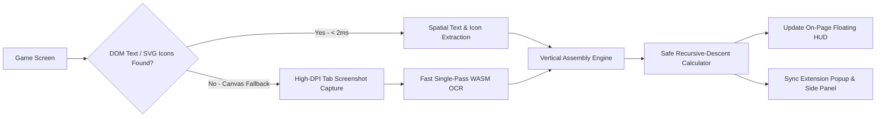

# Matiks Companion

[](https://developer.chrome.com/docs/extensions/mv3/intro/)
[](https://react.dev/)
[](https://vitejs.dev/)
[](https://vitest.dev/)
[](#privacy--compliance)
[](LICENSE)

An ultra-low-latency, 100% client-side Chrome Manifest V3 browser extension and developer engineering laboratory built for real-time arithmetic recognition, live speed-math practice, and OCR benchmarking.

---

## ⚡ Key Highlights

- **Dual-Path Instant Detection (< 20ms)**: Combines instant DOM text & SVG icon parsing directly from the game viewport with an ultra-fast local WebAssembly OCR fallback.
- **Vertical & Multi-Line Arithmetic Assembly**: Solves stacked column equations typical of speed-math games (e.g. `5 \n + 41 \n - 3` $\to$ `43`, `66 \n + 9` $\to$ `75`, `2 \n × 6` $\to$ `12`).
- **Tabular Kerning Defense**: Automatically collapses spaced digits (`+4 1` $\to$ `+41`) caused by tabular monospace rendering.
- **Persistent On-Page Floating HUD**: Floats seamlessly beside the game board inside an isolated Shadow DOM (`#matiks-companion-root`) — draggable, minimizable into an ambient pill, and immune to game focus loss.
- **Continuous Live Tracking**: Real-time 80ms polling loop with a low-latency `MutationObserver` that detects and solves new equations the moment they render on screen.
- **Safe Math Engine (Zero `eval`)**: A deterministic recursive-descent parser supporting powers (`^`, `**`), roots (`√`, `sqrt`), percentages, implicit multiplication, and IEEE-754 decimal stabilization (`0.1 + 0.2 = 0.3`).
- **Developer OCR & Benchmark Suite**: Ground-truth benchmarking lab evaluating Character Error Rate (CER), Levenshtein Distance, Digit Accuracy, and Latency percentiles across 110+ procedural permutations.
- **Chrome MV3 Side Panel & Popup**: Supports docked Chrome Side Panel viewing alongside popup and on-page HUD controls.

---

## 🏗 System Architecture

```text
matiks-companion/
├── src/
│   ├── engine/                # Safe recursive-descent math parser (zero eval)
│   │   ├── calculator.js      # Float stabilization & execution
│   │   ├── normalizer.js      # Unicode, colon, slash & implicit multiplication normalizer
│   │   ├── parser.js          # Grammar, precedence, powers & square roots
│   │   ├── validator.js       # Epsilon tolerance validation
│   │   └── index.js
│   │
│   ├── ocr/                   # Local WebAssembly OCR & diagnostics
│   │   ├── image-processor.js # Dynamic scaling, quiet zones, adaptive thresholding
│   │   ├── ocr-engine.js      # Single-pass fast OCR (<150ms) & multi-pass consensus
│   │   └── extract-expression.js # Vertical multi-line assembly & spaced digit collapse
│   │
│   ├── content/               # Chrome MV3 Content Script & On-Page HUD
│   │   ├── dom-extractor.js   # Spatial bounds targeting, DOM text & SVG math icon parsing
│   │   ├── companion-overlay.js # Shadow DOM floating HUD (draggable, minimizable)
│   │   ├── image-capture.js   # High-DPI canvas cropping & region selection
│   │   └── index.js           # Sub-100ms live tracking loop & message hub
│   │
│   ├── background/            # Chrome MV3 Service Worker
│   │   └── service-worker.js  # Tab capture & async delegation
│   │
│   ├── popup/                 # Extension popup & Side Panel interface
│   │   ├── App.jsx            # Live state sync, scratchpad & tracking toggles
│   │   └── main.jsx
│   │
│   ├── benchmark/             # Ground-truth evaluation framework
│   │   ├── dataset.js         # 110+ ground truth test permutations
│   │   ├── image-generator.js # Procedural canvas generator
│   │   ├── metrics.js         # CER, Levenshtein, digit accuracy, latency metrics
│   │   └── runner.js          # Automated benchmark runner
│   │
│   ├── components/            # Dark-themed Developer Lab UI
│   │   ├── Dashboard.jsx
│   │   ├── OcrLab.jsx
│   │   ├── BenchmarkLab.jsx
│   │   ├── Settings.jsx
│   │   └── Navigation.jsx
│   │
│   ├── App.jsx
│   ├── main.jsx
│   └── style.css
│
├── test/                      # Vitest test suites (65 automated unit tests)
│   ├── arithmetic.test.js     # Safe math evaluation & operator precedence
│   ├── multiline.test.js      # Multi-line vertical column assembly & game cases
│   ├── ocr-ambiguity.test.js  # Optical confusion detection (6 vs 0, 8 vs 3)
│   └── metrics.test.js        # CER & accuracy metric verification
│
├── public/                    # Extension static assets & Manifest
│   ├── manifest.json          # Chrome MV3 config (activeTab, sidePanel, scripting)
│   ├── icon16.png
│   ├── icon48.png
│   └── icon128.png
│
├── index.html                 # Developer Lab web entry point
├── popup.html                 # Extension Popup / Side Panel HTML entry point
├── vite.config.js             # Vite app & extension build configuration
├── vite.content.config.js     # Standalone IIFE content script bundler
└── package.json
```

---

## 🚀 Getting Started

### Prerequisites
- Node.js `v18.0.0` or higher
- npm or pnpm
- Google Chrome or Chromium-based browser (Brave, Edge, Arc)

### 1. Installation
```bash
git clone https://github.com/your-username/matiks-companion.git
cd matiks-companion
npm install
```

### 2. Run Automated Test Suite
Run the 65 unit test cases covering the recursive-descent math engine, multi-line vertical assembly, and OCR disambiguation:
```bash
npm test
```

### 3. Launch the Developer Web Lab
Start the interactive developer workbench (Dashboard, OCR Engineering Lab, Benchmark Suite):
```bash
npm run dev
```
Navigate to [http://localhost:5173](http://localhost:5173) in your browser.

### 4. Build Production Chrome Extension
Compile both the React application and the self-contained IIFE content script:
```bash
npm run build
```
This produces all extension assets inside the `dist/` directory.

---

## 🧩 Loading the Extension into Chrome

1. Build the extension using `npm run build`.
2. Open Chrome and navigate to `chrome://extensions/`.
3. Toggle **Developer mode** in the top-right corner to **ON**.
4. Click **Load unpacked** in the top-left corner.
5. Select the **`dist/`** directory inside this repository.
6. Navigate to your math practice match (e.g., `matiks.com`).
7. The floating **Matiks Companion HUD** will mount directly onto the page and begin tracking equations automatically.

---

## 🎯 How It Works

### 1. Dual-Path Equation Detection


### 2. Tabular Monospace Kerning Defense
Speed-math games frequently render multi-digit numbers with fixed tabular spacing (e.g. `+ 4  1` or `+4 1`). The pipeline incorporates regular-expression based lookahead clustering to collapse fragmented digits prior to mathematical evaluation:
$$\text{"}+4\ 1\text{"} \longrightarrow \text{"+41"}$$

### 3. Isolated Floating Shadow DOM
To prevent game stylesheet bleed or React Native Web CSS class conflicts, the companion's HUD is encapsulated inside a Shadow Root (`#matiks-companion-root`). The HUD provides:
- Live equation detection feed.
- High-contrast neon answer display.
- One-click minimize toggle (collapses into an ambient status pill).
- Smooth dragging across the viewport.

---

## 🛡 Privacy & Compliance

- **100% Offline & Private**: Zero external network requests, zero telemetry, and zero third-party cloud APIs. All OCR and math evaluation run locally inside your browser via WebAssembly and native DOM APIs.
- **Practice Companion Only**: Designed strictly as an educational companion for mental math practice, speed drills, and developer OCR benchmarking. It **does not** automatically fill or submit answers into the game.

---

## 📄 License

Distributed under the [MIT License](LICENSE).
